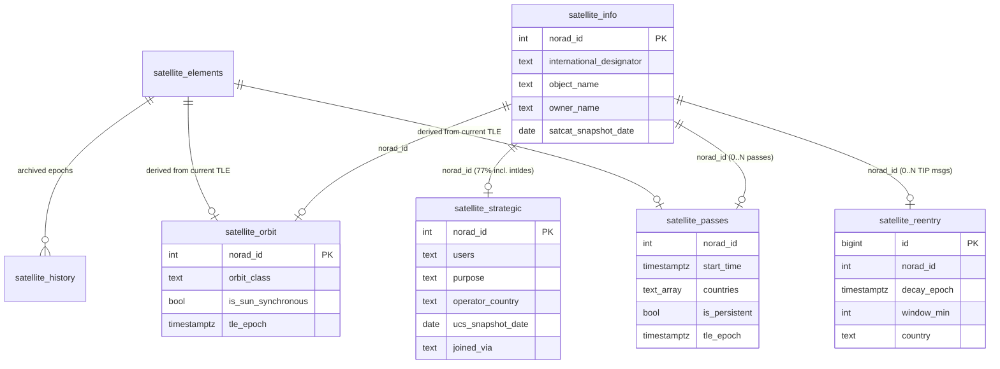

# Atheer RADAR (scraplan) Satellite Research Base — Architecture & Methodology

**Status:** capstone-complete · **Reference snapshot:** 2026-07-19
**Scope:** a research foundation for regional (seven-country, Eastern-Mediterranean)
space-activity analysis.

This is the citable reference for scraplan's satellite research base. It documents
what each layer is, where its facts come from and at what vintage, how the layers
join, and — critically for a research base — the **methodological discipline** a
study must follow to use it correctly. It is accurate to the implemented schema
(migrations `016`–`020` plus the CelesTrak TLE substrate, `009`/`011`).

> **One-line citation form:** "scraplan satellite research base, layer `<name>`
> (`source=<…>`, vintage `<date/epoch>`), reference snapshot 2026-07-19."

---

## 1. Overview & purpose

The base turns raw orbital data into a **multi-layer, provenance-dated, join-ready**
picture of what is in orbit over — and passing over — the seven-country region
(Syria, Turkey, Iraq, Jordan, Lebanon, Israel, Cyprus). It exists to support
**analyses and studies**, not just a live map.

**Core design principle — layered, independently-sourced, provenance-dated facts
joined by NORAD id:**

- Each analytical concern is a **separate layer** (its own table), never merged
  into another. Identity, strategic classification, orbit, reentry, and regional
  passes are distinct tables.
- Each layer carries its **own source and vintage** on every row. A study can — and
  must — select, e.g., "SATCAT identity (2026) + UCS strategic class (2023)" with
  full provenance, and **never silently collapse vintages**.
- All layers share one spine: the **NORAD catalog id** (`norad_id`). Any layer joins
  to any other by `norad_id`.
- Layers never overwrite each other. A live-derived orbit class sits *beside* UCS's
  2023 self-reported one; a study can compare them.

The base is a **sampling frame**, not a census: it tracks CelesTrak's curated active
groups (~800 payloads), not the full ~50k+ catalog (see §4, §6).

---

## 2. The layers

The substrate is the cached TLE set; six layers build on it. `S2a` is a *connection
foundation* (an authenticated client), not a table — it enables the reentry layer.

| Layer | Table(s) | Migration | Source | Vintage / freshness |
|---|---|---|---|---|
| **TLE substrate** | `satellite_elements`, `satellite_history` | 009, 011 | CelesTrak (keyless) | live, refreshed every 6 h |
| **S1 · Identity** | `satellite_info` | 016 | CelesTrak **SATCAT** | dated snapshot (2026-07-17) |
| **S2a · Space-Track client** | *(no table)* | — | Space-Track (authenticated) | live connection |
| **S2c · Reentry** | `satellite_reentry` | 017 | Space-Track **TIP** | daily, forward+recent window |
| **Sat-UCS · Strategic** | `satellite_strategic` | 018 | **UCS** Satellite Database | **FROZEN 2023-05-01** |
| **Sat-Orbit · Orbit class** | `satellite_orbit` | 019 | derived (python-sgp4) | live, recomputed each TLE refresh |
| **Sat-Passes · Regional passes** | `satellite_passes` | 020 | derived (python-sgp4) | live, recomputed each TLE refresh |

Provenance column legend used throughout: `source` (origin label), a *vintage* column
(`satcat_snapshot_date` / `ucs_snapshot_date` / `tle_epoch`), `joined_via` (how a row
was matched), and a *compute/fetch* stamp (`computed_at` / `fetched_at` /
`source_updated_at`).

---

### 2.0 Substrate — CelesTrak TLEs (`satellite_elements`, `satellite_history`)

- **Provides:** the two-line element sets (TLEs) every derived layer is computed
  from, per CelesTrak group.
  - `satellite_elements` (current, fast-serve): `norad_id, grp, object_name,
    tle_line1, tle_line2, epoch, fetched_at` — **PK `(norad_id, grp)`**. Refreshed
    per group by `DELETE grp + INSERT` (membership never goes stale).
  - `satellite_history` (append-only): `epoch, norad_id, grp, object_name,
    tle_line1, tle_line2, fetched_at` — **PK `(norad_id, epoch, grp)`**; every
    fetched element preserved (past-orbit replay).
- **Source & vintage:** CelesTrak `gp.php`, keyless; **live** (each TLE has its own
  `epoch`). Ground truth is the append-only `satellite_output/tle.jsonl`.
- **Refresh:** `scraplan-satellites.service` (systemd **timer** `00,06,12,18:20`,
  `Persistent=true`), i.e. every 6 h.
- **Catalog scope:** 8 configured groups (`stations, gps-ops, galileo, weather,
  noaa, science, military, geo`); **7 populate** — `noaa` is configured but returns
  0 rows (see §6). Present distribution: `geo 570, weather 74, science 49, gps-ops
  32, galileo 32, military 24, stations 23`. **783 distinct NORAD ids** tracked.

---

### 2.1 S1 — SATCAT identity (`satellite_info`)

- **Provides:** authoritative catalog identity per object —
  `international_designator, object_name, object_type` (PAY / R/B / DEB / UNK), `owner`
  (CelesTrak code) + decoded `owner_name`, `launch_date, launch_site, decay_date,
  ops_status, rcs_m2`. **PK `norad_id`.**
- **Source & vintage:** CelesTrak **SATCAT** (whole-catalog CSV). A **dated
  snapshot** — the whole-catalog dump's HTTP `Last-Modified`. Current snapshot
  **2026-07-17**.
- **Provenance columns:** `source='celestrak_satcat'`, `satcat_snapshot_date`
  (2026-07-17), `source_updated_at` (bumped only on a real change), `fetched_at`.
- **Coverage note:** enriched for the tracked catalog **and** for reentry objects
  (so reentry events carry identity). Current rows: **908**.
- **Refresh:** offline bulk, `scripts/backfill_from_satcat.py` (idempotent,
  blank-safe COALESCE). Re-run when the SATCAT dump is refreshed.

### 2.2 S2a — Space-Track authenticated client (`backend/spacetrack_client.py`)

- **Provides:** the connection foundation for Space-Track-sourced layers — cookie
  session (login once, reused), a strict rate limiter (defaults **20/min, 200/hour**,
  under Space-Track's published **<30/min, <300/hour** ceiling), exponential backoff
  on 429/503/network, single 401 re-login, and Alpha-5 decode helpers. **No table.**
- **Source & vintage:** Space-Track.org, authenticated (`SPACETRACK_USER` /
  `SPACETRACK_PASS` from env, never in code/git). Live.
- **Used by:** S2c (reentry). Extensible to other Space-Track classes (gp,
  gp_history, satcat, decay) without re-implementing auth/limits.

### 2.3 S2c — Reentry / decay predictions (`satellite_reentry`)

- **Provides:** predicted reentries from Space-Track's **TIP** (Tracking & Impact
  Prediction) class, geo-linked to the AOI:
  `id` (TIP message id), `norad_id, msg_epoch, insert_epoch, decay_epoch,
  window_min` (± minutes), `lat, lon` (nominal predicted impact point, lon
  normalized to −180…180), `direction, incl, rev, next_report, high_interest`, plus
  AOI classification `country, near_country, distance_km, geo_source`. **PK `id`**
  (append-only: each TIP message is a row → the refinement history is preserved; the
  API surfaces the latest per object).
- **Source & vintage:** Space-Track TIP via the S2a client. Live; a
  **daily** forward+recent window (default `--lookback-days 60`).
- **Provenance columns:** `source='spacetrack_tip'`, `geo_source='scraplan-aoi'`,
  `fetched_at`; `msg_epoch` dates each prediction.
- **Geo-linking:** the nominal impact point is classified with the shared
  `backend/geo_area.py` (seven-country INSIDE/NEAR + 50 km buffer), identical to
  aircraft/vessels.
- **Refresh:** `scraplan-reentry.service` (systemd **timer** `05:30` daily,
  `Persistent=true`). Ground truth: `satellite_output/reentry.jsonl`. Current:
  **808 TIP messages / 125 distinct objects**.

### 2.4 Sat-UCS — Strategic classification (`satellite_strategic`)

- **Provides:** the strategic axis the identity/orbit layers lack —
  `users` (civil/commercial/government/military + combos), `purpose,
  detailed_purpose, operator, operator_country, registry_country, orbit_class`
  (UCS's own), `orbit_type, launch_mass_kg, power_watts, expected_lifetime_yrs,
  contractor, launch_site`. **PK `norad_id`.**
- **Source & vintage:** **UCS Satellite Database** — **FROZEN at 2023-05-01** (the
  project paused updates). This is a **historical baseline, not current state.**
- **Provenance columns:** `source='ucs'`, `ucs_snapshot_date` (2023-05-01),
  `joined_via` (`norad` | `intldes`), `fetched_at`.
- **Join / coverage (honest):** matched to our catalog by **NORAD id first, COSPAR/
  international-designator fallback**. Of 908 catalogued objects, **703 matched
  (77.4%)** — 701 via `norad`, 2 via `intldes`; **205 unmatched** (post-2023 objects
  UCS never saw). A separate table by design so the 2023 vintage never mixes into
  the current identity layer.
- **Refresh:** offline bulk, `scripts/backfill_from_ucs.py` (idempotent, blank-safe).
  Static until UCS resumes.

### 2.5 Sat-Orbit — Live orbit classification (`satellite_orbit`)

- **Provides:** deterministic orbit class + elements **computed from the current
  TLE** — `orbit_class` (LEO/MEO/GEO/HEO/other), `apogee_km, perigee_km,
  eccentricity, inclination_deg, period_min, mean_motion, semimajor_axis_km`,
  `is_geostationary` (bool), `is_sun_synchronous` (bool, **NULL for non-LEO**).
  **PK `norad_id`.**
- **Documented, citable thresholds** (evaluated in order): `HEO` if ecc ≥ 0.25;
  else `LEO` if apogee < 2000 km; else `GEO` if |mean altitude − 35786 km| ≤ 1500 km;
  else `MEO` if 2000 ≤ mean altitude < 34286 km; else `other`. `is_geostationary` =
  GEO + inclination ≤ 1° + ecc ≤ 0.01 + period within 30 min of one sidereal day.
  `is_sun_synchronous` (LEO only) = nodal precession matching the mean-solar rate
  (0.98565°/day) within 1° of the required inclination.
- **Source & vintage:** derived via **python-sgp4** (WGS-72). Live, **recomputed
  each TLE refresh**. `source='derived-sgp4'`, `tle_epoch` (the TLE it was computed
  from), `computed_at`. This table is a **cache of the latest derivation** — a newer
  TLE updates the row.
- **Refresh:** `scripts/backfill_orbit.py`, wired as an `ExecStartPost` on
  `scraplan-satellites.service` (runs right after each TLE refresh). Current: **781
  rows** — `GEO 570, LEO 134, MEO 64, HEO 12, other 1`.

### 2.6 Sat-Passes — Regional passes (`satellite_passes`)

- **Provides:** which satellites pass over the AOI and when, over a forward window —
  `norad_id, start_time, end_time, duration_s`, `countries` (TEXT[] the ground track
  crossed INSIDE), `near_countries` (TEXT[]), `closest_km`, `is_persistent` (GEO
  stationing flag), `n_points`. **PK `(norad_id, start_time)`.**
- **Pass definition (documented, observer-independent):** a contiguous interval where
  the satellite's **sub-satellite ground-track point** is INSIDE a seven-country
  polygon OR NEAR it (`geo_area.py`'s 50 km buffer — the same classifier every geo
  layer uses). Sub-point = SGP4 TEME → ECEF (GMST) → WGS-84 geodetic, validated
  against `skyfield` to < 0.001°. Time-step **60 s** over a forward **24 h** window
  (both configurable). **GEO special case:** a geosync sub-point is ~equatorial and
  never over the northern AOI, so a GEO is instead flagged "stationed over the AOI
  longitude band" and emits at most one `is_persistent=TRUE` row.
- **Source & vintage:** derived via **python-sgp4** (batched `SatrecArray`). Live;
  a **forward-window prediction** (`window_start`/`window_end`), recomputed and
  **replaced** each run (DELETE+INSERT). `source='derived-sgp4'`, `tle_epoch`,
  `computed_at`.
- **Refresh:** `scripts/backfill_passes.py`, the second `ExecStartPost` in the chain
  (`tracker_satellites → backfill_orbit → backfill_passes`). Runtime ≈ **1.3 s** for
  781 sats × 1441 samples. Current (24 h window): **355 passes / 176 distinct
  satellites / 31 GEO-persistent**.

---

## 3. The join model

### The NORAD-id spine

Every layer keys on (or carries) `norad_id`. `satellite_info` also carries
`international_designator`, which is how UCS was matched when a NORAD id did not line
up (`joined_via='intldes'`). There are **no foreign keys** — layers are deliberately
independent (a study may keep, e.g., a strategic row for an object no longer in the
tracked set) — so joins are `LEFT JOIN` by convention and coverage gaps are explicit.



### Example cross-layer queries

**(a) Identity + strategic + orbit side by side** — each fact with its own vintage:

```sql
SELECT i.norad_id, i.object_name,
       i.owner_name, i.satcat_snapshot_date,        -- identity (SATCAT, 2026)
       s.users, s.purpose, s.ucs_snapshot_date,     -- strategic (UCS, 2023)
       o.orbit_class, o.tle_epoch                    -- orbit (derived, live)
FROM satellite_info i
LEFT JOIN satellite_strategic s USING (norad_id)
LEFT JOIN satellite_orbit     o USING (norad_id)
WHERE i.norad_id = 25544;
```

**(b) Upcoming reentries predicted over/near the region, with identity:**

```sql
SELECT DISTINCT ON (r.norad_id)
       r.norad_id, i.object_name, i.owner_name,
       r.decay_epoch, r.window_min, r.lat, r.lon, r.country, r.near_country
FROM satellite_reentry r
LEFT JOIN satellite_info i USING (norad_id)
WHERE (r.country IS NOT NULL OR r.near_country IS NOT NULL)
ORDER BY r.norad_id, r.msg_epoch DESC;     -- latest prediction per object
```

**(c) THE capstone query — military-involved satellites (per UCS) overflying the AOI
in the current window, by operator-country, joining passes + strategic + identity +
orbit:**

```sql
SELECT s.operator_country,
       count(DISTINCT p.norad_id)                    AS mil_sats_overflying,
       array_agg(DISTINCT i.object_name) FILTER (WHERE i.object_name IS NOT NULL)
                                                     AS examples
FROM satellite_passes    p
JOIN satellite_strategic s USING (norad_id)          -- UCS user class
JOIN satellite_info      i USING (norad_id)          -- identity
JOIN satellite_orbit     o USING (norad_id)          -- (live orbit, if needed)
WHERE s.users ILIKE '%military%'
GROUP BY s.operator_country
ORDER BY mil_sats_overflying DESC;
```

Result on the reference snapshot (24 h window): **USA 12, France 2, Russia 2, Germany
1, France/Italy 1, Egypt 1, Canada 1.** A single joined row, e.g.: *NAVSTAR 56 (USA
180)* — SATCAT identity (2026-07-17) + UCS `Military/Commercial · Navigation/GPS ·
USA` (2023-05-01) + live orbit `MEO` + a pass over **Cyprus & Turkey**.

> **Coverage caveat for (c):** the `JOIN satellite_strategic` restricts to
> UCS-classified objects. Post-2023 objects have **no** UCS row and are excluded — a
> `LEFT JOIN` with `s.users IS NULL` shows how many AOI-passers are unclassifiable
> (76 on the reference snapshot). Always report this (see §4).

---

## 4. Methodological guidance for studies

A study using this base **must** state the following. These are not caveats to bury;
they define what the data can and cannot support.

1. **Vintage discipline (UCS is frozen 2023-05-01).** Any use of strategic class
   (`users`, `purpose`, `operator*`) MUST report the **2023-05-01** vintage and treat
   **post-2023 objects as unclassified** — do not infer their class. Current UCS join
   coverage is **703/908 = 77.4%** (`joined_via`: 701 norad, 2 intldes); **205
   objects unmatched**, of which **76 are among the AOI-passers**. Never present a
   UCS-derived count as complete without stating this frame.

2. **Reentry uncertainty (use the window, not the point).** TIP predictions carry a
   `window_min` of **± hundreds to thousands of minutes**; `lat`/`lon` is a **nominal
   point estimate**, not a precise impact site. Studies must reason with the window
   (and `next_report`), and treat AOI classification of the nominal point as
   indicative, not a claim that debris will land in that country.

3. **Derivation basis & TLE age (orbit + passes).** `orbit_class` and passes are
   computed from the **latest TLE** (recorded in `tle_epoch`). TLE accuracy degrades
   ~1 km/day from epoch, so **pass predictions are most reliable near `tle_epoch`**
   and within the near-term forward window. Passes are a **forward-window prediction,
   not observed fact**; the window slides with each recompute (`window_start`/
   `window_end`). For a fixed study, pin the `tle_epoch` and window used.

4. **Catalog scope / sampling frame.** The base tracks **CelesTrak's curated groups
   (~800 active payloads / 783 distinct NORAD ids)**, NOT the full ~50k+ catalog.
   Debris and analyst objects are **excluded by design**. State this sampling frame
   explicitly; conclusions generalize to *tracked active payloads in these groups*,
   not to "all objects." Note the **`noaa` group is currently empty** (§6).

5. **Alpha-5 / 6-digit ids.** The catalog crossed 100,000 on 2026-07-11; TLEs encode
   >99,999 as Alpha-5. Parsing (`parse_3le` → `alpha5_to_int`) and SGP4 handle
   6-digit ids correctly — they are **not silently dropped**. `norad_id` is always the
   decoded integer.

6. **Provenance — cite per-layer, never collapse.** Every fact carries `source` + a
   vintage/epoch. A correct citation names the layer *and* its vintage (e.g. "orbit
   class as of TLE epoch 2026-07-18; strategic class as of UCS 2023-05-01"). Do not
   present a joined row as if all facts share one date.

---

## 5. Reproducibility

Each layer rebuilds deterministically from **ground truth** (append-only JSONL
archives) or from a **dated external snapshot**. External snapshots are large and
**gitignored** (`enrichment_data/`, `satellite_output/`) — they are fetched, not
committed — so record the version used in any study.

| Layer | Rebuild command | Ground truth / snapshot (version) |
|---|---|---|
| TLE substrate | `python tracker_satellites.py` (live) · `python tracker_satellites.py backfill --archive satellite_output` | `satellite_output/tle.jsonl` (append-only) |
| S1 identity | `python scripts/backfill_from_satcat.py --snapshot-date 2026-07-17` | `enrichment_data/satcat.csv` — `curl -sL -o enrichment_data/satcat.csv https://celestrak.org/pub/satcat.csv` (snapshot = HTTP `Last-Modified`, **2026-07-17**) |
| S2c reentry | `python tracker_reentry.py` (live) · `python tracker_reentry.py backfill --archive satellite_output` | `satellite_output/reentry.jsonl` (append-only); creds `SPACETRACK_USER`/`SPACETRACK_PASS` in `.env` |
| Sat-UCS strategic | `python scripts/backfill_from_ucs.py --snapshot-date 2023-05-01` | `enrichment_data/ucs-satellite-database.tsv` — `curl -sL -o enrichment_data/ucs-satellite-database.tsv https://www.ucs.org/media/11493` (**UCS 2023-05-01**, ISO-8859/tab-delimited) |
| Sat-Orbit | `python scripts/backfill_orbit.py` | derived from `satellite_elements` (current TLEs) |
| Sat-Passes | `python scripts/backfill_passes.py [--window-hours 24 --step-seconds 60]` | derived from `satellite_elements` (current TLEs) |

Notes:
- **Idempotent:** every backfill re-run with the same input changes 0 rows (blank-safe
  COALESCE + change-guards), except Sat-Passes, whose forward window slides with
  wall-clock (same TLEs **and** window ⇒ identical passes).
- **Migrations** `009`, `011`, `016`–`020` define the schema; apply with
  `python migrate.py` (each runs once; checksum-verified).
- **Runtime services** (production currency): `scraplan-satellites.timer` (6-hourly)
  drives `tracker_satellites → backfill_orbit → backfill_passes`;
  `scraplan-reentry.timer` (daily 05:30) drives `tracker_reentry`. Both
  `Persistent=true` (missed runs catch up after downtime).

---

## 6. Known limitations & gaps (frank)

- **UCS is frozen at 2023-05-01** and covers **77.4%** of the tracked catalog. The
  205 unmatched objects (76 of them AOI-passers) are post-2023 and **strategically
  unclassifiable** from this base. Any strategic-axis result is a 2023-vintage,
  partial-coverage statement.
- **Reentry predictions are uncertain by nature** — large `window_min`, nominal
  point. Do not treat the impact `lat`/`lon` or its AOI country as precise.
- **TLE-age accuracy** — derived orbit/passes degrade with time from `tle_epoch`
  (~1 km/day); far-future passes in the window are less reliable than near-term ones.
- **Curated-catalog sampling** — ~800 active payloads across 7 populated CelesTrak
  groups, not the full catalog; debris/analyst objects excluded by design.
- **`noaa` group is empty** — configured in `DEFAULT_GROUPS` but currently returns 0
  rows from CelesTrak (cause unverified; likely a group-name/availability change).
  NOAA weather satellites may therefore be under-represented; treat weather/Earth-obs
  coverage as incomplete until resolved.
- **GEO passes use a longitude-band proxy**, not polygon containment (a geosync
  sub-point is equatorial, never over the northern AOI). `is_persistent=TRUE` rows are
  "stationed over the AOI longitude band," a different notion from a LEO overflight —
  filter on `is_persistent` when the distinction matters.
- **Space-Track/TIP scope** — TIP is issued only for imminent/high-interest reentries;
  absence of a reentry row is not evidence an object is not decaying.
- **Coordinate/timing simplifications** — sub-points use GMST rotation without polar
  motion/nutation (sub-degree, ample for country polygons, not for precision
  geolocation). All timestamps are UTC.

---

## Appendix — reference-snapshot state (2026-07-19)

| Table | Rows | Notes |
|---|---|---|
| `satellite_elements` | 804 | 783 distinct NORAD ids; 7 groups (noaa empty) |
| `satellite_history` | 8,031 | append-only TLE epochs |
| `satellite_info` | 908 | SATCAT 2026-07-17 |
| `satellite_reentry` | 808 | 125 distinct objects (TIP messages) |
| `satellite_strategic` | 703 | UCS 2023-05-01; 77.4% of 908 |
| `satellite_orbit` | 781 | GEO 570 / LEO 134 / MEO 64 / HEO 12 / other 1 |
| `satellite_passes` | 355 | 176 distinct sats / 31 persistent (24 h window) |

**Layer commits:** `sat-s2a` (0c00d60) · `sat-s1` (585e61e) · `sat-s2c` (7c6a335) ·
`sat-ucs` (4488f4f) · `sat-orbit` (47b47cd) · `sat-passes` (352f60f).

**Shared AOI:** `backend/geo_area.py` — seven countries (Syria, Turkey, Iraq, Jordan,
Lebanon, Israel, Cyprus), 50 km border buffer, AEQD projection, `geo_source='scraplan-aoi'`.
