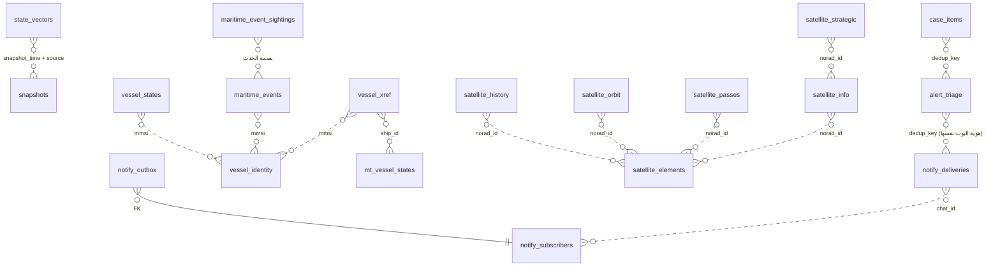

# مخطط قاعدة opensky — مولَّد آلياً

آخر هجرة: **052_case_items.sql** · جداول: 33 · hypertables: 5 · وُلِّد 2026-09-01 عبر `scripts/generate_erd.py` — لا يُحرَّر يدوياً.

العلاقة المُعلنة الوحيدة FK: `notify_outbox → notify_subscribers` (هجرة 040) — البقية منطقية يفرضها التطبيق (TimescaleDB يمنع FK نحو hypertable).

## المجال الجوي

### `air_country_daily` (≈666 صف)
ملخص يومي: أجسام متمايزة لكل (يوم، بلد، مصدر) — وحدة الجمع عبر الأيام «بدن-يوم» لا أجسام
`day`🔑, `country`🔑, `source`🔑, `distinct_hulls`, `rows`, `computed_at`

### `aircraft_info` (≈22k صف)
ذاكرة إثراء الطائرات (adsbdb + planespotters) مع TTL — «القديم يغلب اللاشيء» عند تعذّر المنبع
`icao24`🔑, `found`, `registration`, `aircraft_type`, `icao_type`, `manufacturer`, `operator`, `operator_country`, `photo_thumb`, `photo_page`, `photographer`, `fetched_at`, `registration_country`, `registration_country_source`, `registration_country_derived_at`, `source`, `csv_snapshot_date`, `source_updated_at`, `registration_source`, `aircraft_type_source`, `icao_type_source`, `manufacturer_source`, `operator_source`

### `flight_routes` (≈166 صف)
المسار القياسي لكل نداء (adsbdb) — بيانات قارّة تُخزَّن بالنداء لا بالرحلة
`callsign`🔑, `found`, `airline_name`, `airline_icao`, `origin_icao`, `origin_iata`, `origin_name`, `origin_municipality`, `origin_country`, `origin_lat`, `origin_lon`, `dest_icao`, `dest_iata`, `dest_name`, `dest_municipality`, `dest_country`, `dest_lat`, `dest_lon`, `fetched_at`

### `snapshots` (≈165k صف)
لقطة تجميع لكل دورة جمع جوية؛ /live يقرأ الأرشيف أولاً ثم أحدث لقطة كاملة هنا
`snapshot_time`🔑, `source`🔑, `ts`, `lamin`, `lomin`, `lamax`, `lomax`, `count`, `complete`, `generated_at`, `ingested_at`

### `state_vectors` · hypertable (≈— صف)
كل نقطة مسار جوية من المصادر الثلاثة (opensky / airplanes_live / adsbexchange) — المفتاح الطبيعي (icao24, ts, source)
`ts`🔑, `snapshot_time`, `icao24`🔑, `source`🔑, `callsign`, `origin_country`, `time_position`, `last_contact`, `longitude`, `latitude`, `baro_altitude`, `geo_altitude`, `on_ground`, `velocity`, `true_track`, `vertical_rate`, `squawk`, `spi`, `position_source`, `category`, `fetched_at`, `actype`, `acdesc`, `reg`, `country`, `near_country`, `position_quality`, `validation_flags`, `distance_km`, `geo_source`

### `state_vectors_1m` (≈— صف)
view — التجميع المستمر الدقائقي فوق state_vectors؛ مصدر /stats (لا مسح للصفوف الخام أبداً)
`bucket`, `source`, `state_count`, `ground_count`, `max_baro_altitude`, `max_geo_altitude`, `max_velocity`

## المجال البحري

### `maritime_event_sightings` (≈72k صف)
أول رصد لكل حدث بحري — خارج maritime_events عمداً لأن تلك تُعاد؛ الصفوف هنا لا تُحذف أبداً
`event_type`🔑, `source`🔑, `vessel_key`🔑, `start_ts`🔑, `first_seen_at`

### `maritime_events` (≈88k صف)
أحداث الكواشف البحرية (فجوات AIS، التقاءات A2، تغيّر هوية A3، شذوذ GNSS، مكوث المناطق) — ⛔ تُهدَم ويُعاد بناؤها بإعادة الحساب
`event_type`🔑, `mmsi`, `start_ts`🔑, `end_ts`, `imo`, `start_lat`, `start_lon`, `end_lat`, `end_lon`, `duration_s`, `classification`, `method`, `detail`, `computed_at`, `ship_id`, `source`🔑, `vessel_key`🔑, `first_seen_at`

### `maritime_hull_composite` (≈— صف)
view — الرؤية المركّبة لكل هيكل: أنماط MMSIهات الهيكل الواحد مجموعةً بالهوية (هجرات 026/029/037) — أساس تنبيهات maritime_composite
`hull`, `n_gaps`, `n_rendezvous`, `n_identity_changes`, `n_gnss_anomaly`, `n_imo_integrity`, `n_zone_dwell`, `n_pattern_types`, `first_event_ts`, `last_event_ts`, `first_seen_at`, `n_events_first_seen`, `n_events`, `mmsis`

### `maritime_hull_events` (≈— صف)
view — أحداث الأنماط مُسنَدة إلى هوية الهيكل مع طابع أول رصد (هجرة 049)
`hull`, `event_type`, `via_mmsi`, `imo`, `start_ts`, `end_ts`, `duration_s`, `detail`, `first_seen_at`, `as_partner`

### `mt_vessel_states` · hypertable (≈— صف)
مواقع MarineTraffic (mtscraper) — مصدر بحري مستقل ثانٍ (هجرتا 032/033)
`ts`🔑, `ship_id`🔑, `source`🔑, `data_origin`, `mmsi`, `latitude`, `longitude`, `speed`, `course`, `heading`, `nav_status`, `imo`, `name`, `callsign`, `ship_type_code`, `ship_type`, `destination`, `draught`, `length_m`, `beam_m`, `flag`, `country`, `near_country`, `distance_km`, `geo_source`, `ingested_at`, `position_quality`, `anomaly_flags`, `implied_speed_kn`, `inland_km`, `quality_method`, `quality_computed_at`

### `vessel_identity` (≈7k صف)
العمود الفقري لهوية السفينة بالـMMSI: الاسم/النداء/الأبعاد + محور جودة IMO (فحص checksum، مفاتيح هيكل بديلة — هجرتا 035/036)
`mmsi`🔑, `flag_country`, `station_type`, `flag_source`, `derived_at`, `name`, `ship_type`, `ship_type_code`, `callsign`, `imo`, `length_m`, `beam_m`, `identity_source`, `identity_updated_at`, `imo_quality`, `imo_flags`, `imo_method`, `imo_computed_at`

### `vessel_info` (≈100 صف)
إثراء صور السفن (Wikimedia Commons بالـIMO ثم الاسم) مع الترخيص والنسبة
`mmsi`🔑, `found`, `photo_thumb`, `photo_page`, `photographer`, `license`, `matched_on`, `fetched_at`

### `vessel_snapshots` (≈66k صف)
لقطات التجميع البحرية — نظير snapshots الجوية
`snapshot_time`🔑, `source`🔑, `ts`, `lamin`, `lomin`, `lamax`, `lomax`, `count`, `generated_at`, `ingested_at`

### `vessel_states` · hypertable (≈— صف)
مواقع AIS الحية (AISStream) — مرآة أرضية؛ الغياب ليس دليل غياب
`ts`🔑, `mmsi`🔑, `source`🔑, `data_origin`, `latitude`, `longitude`, `speed`, `course`, `heading`, `nav_status`, `imo`, `name`, `callsign`, `ship_type_code`, `ship_type`, `destination`, `draught`, `country`, `near_country`, `distance_km`, `geo_source`, `position_quality`, `anomaly_flags`, `implied_speed_kn`, `inland_km`, `quality_method`, `quality_computed_at`

### `vessel_tracks` (≈— صف)
view — مسارات AIS وMarineTraffic بشكل واحد موسوم بالمصدر؛ NULL في position_quality تعني «غير مُقيَّم» لا «سليم»
`source`, `key_kind`, `vessel_key`, `ts`, `latitude`, `longitude`, `speed`, `course`, `heading`, `nav_status`, `draught`, `name`, `flag`, `country`, `near_country`, `distance_km`, `position_quality`, `implied_speed_kn`, `ship_type`, `anomaly_flags`, `inland_km`

### `vessel_xref` (≈2k صف)
روابط الهوية المشتقة AIS×MarineTraffic بثقة strong/probable/weak (هجرة 034) — قرائن لا إثبات
`ship_id`🔑, `mmsi`, `name`, `flag`, `link_source`, `linked_at`, `updated_at`, `match_confidence`, `match_score`, `match_distance_km`, `match_dt_minutes`, `match_ambiguous`, `match_reason`

## المجال الفضائي

### `satellite_elements` (≈797 صف)
أحدث TLE لكل قمر (CelesTrak) — مصدر الانتشار المداري
`norad_id`🔑, `grp`🔑, `object_name`, `tle_line1`, `tle_line2`, `epoch`, `fetched_at`

### `satellite_history` · hypertable (≈— صف)
تاريخ العناصر المدارية عبر الزمن
`epoch`🔑, `norad_id`🔑, `grp`🔑, `object_name`, `tle_line1`, `tle_line2`, `fetched_at`

### `satellite_info` (≈783 صف)
هوية SATCAT: التسمية، الدولة، تاريخ الإطلاق، نوع الجسم
`norad_id`🔑, `international_designator`, `object_name`, `object_type`, `owner`, `owner_name`, `launch_date`, `launch_site`, `decay_date`, `ops_status`, `rcs_m2`, `source`, `satcat_snapshot_date`, `source_updated_at`, `fetched_at`

### `satellite_orbit` (≈783 صف)
صنف المدار وخصائصه المشتقة من TLE بمرجع sgp4 (LEO/MEO/GEO/HEO، الأوج/الحضيض/الدور)
`norad_id`🔑, `orbit_class`, `apogee_km`, `perigee_km`, `eccentricity`, `inclination_deg`, `period_min`, `mean_motion`, `semimajor_axis_km`, `is_geostationary`, `is_sun_synchronous`, `source`, `tle_epoch`, `computed_at`

### `satellite_pass_baseline` (≈— صف)
خط أساس هندسة العبور لكل قمر — إرجاع TLE الحالي للخلف؛ توزيعات فقط لا أفراد
`norad_id`🔑, `window_days`, `n_passes`, `passes_per_day`, `closest_min`, `closest_p10`, `closest_median`, `usual_countries`, `method`, `tle_epoch`, `computed_at`

### `satellite_passes` (≈334 صف)
نوافذ المرور فوق منطقة الاهتمام — تنبؤ أمامي ~24 ساعة، ليس تاريخاً مرصوداً
`norad_id`🔑, `start_time`🔑, `end_time`, `duration_s`, `countries`, `near_countries`, `closest_km`, `is_persistent`, `n_points`, `source`, `tle_epoch`, `window_start`, `window_end`, `computed_at`

### `satellite_reentry` (≈947 صف)
بلاغات العودة (Space-Track TIP) — طبقة مرجعية
`id`🔑, `norad_id`, `msg_epoch`, `insert_epoch`, `decay_epoch`, `window_min`, `lat`, `lon`, `direction`, `incl`, `rev`, `next_report`, `high_interest`, `country`, `near_country`, `distance_km`, `geo_source`, `source`, `fetched_at`

### `satellite_strategic` (≈703 صف)
الطبقة الاستراتيجية من UCS (المستخدِم/الغرض/المشغّل) — ⛔ مجمّدة على لقطة 2023
`norad_id`🔑, `users`, `purpose`, `detailed_purpose`, `operator`, `operator_country`, `registry_country`, `orbit_class`, `orbit_type`, `launch_mass_kg`, `power_watts`, `expected_lifetime_yrs`, `contractor`, `launch_site`, `source`, `ucs_snapshot_date`, `joined_via`, `fetched_at`

## التنبيهات والإشعارات

### `alert_triage` (≈— صف)
حالة الترياج الجماعية لكل هوية تنبيه (dedup_key) — غياب الصف يعني «مفتوح»
`dedup_key`🔑, `state`, `change_sig`, `note`, `updated_at`

### `case_items` (≈— صف)
ملف القضية المشترك — يلتقط الادّعاء لقطةً لأن التغذية عديمة الحالة
`dedup_key`🔑, `label`, `domain`, `signal_type`, `severity`, `headline`, `why`, `caveat`, `countries`, `alert_ts`, `note`, `added_at`

### `notify_deliveries` (≈2k صف)
سجل ما أُرسل (NOTIFY-1): مفاتيح وتواقيع تغيّر فقط، لا محتوى
`dedup_key`🔑, `family`, `signal_type`, `change_sig`, `sent_at`, `last_seen_at`, `send_count`

### `notify_outbox` (≈0 صف)
طابور التسليم لكل (مشترك، حدث) — يُحذف عند النجاح؛ إعادة المحاولة لكل مستلم
`id`🔑, `chat_id`, `dedup_key`, `body`, `queued_at`, `attempts`, `next_attempt_at`, `last_error`

### `notify_runner_state` (≈1 صف)
حالة المشغّل: ختم خط الأساس البارد + ساعة الملخّص — صف واحد
`id`🔑, `baselined_at`, `digest_sent_at`, `update_offset`

### `notify_subscribers` (≈3 صف)
مشتركو بوت تيليغرام — chat_id بيانات شخصية و/delete يمحو الصف
`chat_id`🔑, `status`, `subscribed_at`, `status_changed_at`, `cursor_at`, `countries`, `families`, `sent_count`, `last_sent_at`, `last_error`, `verbosity`

## البنية والتشغيل

### `schema_migrations` (≈— صف)
سجل الهجرات المطبَّقة مع بصمة sha256 لكل ملف — مُدقَّق عند كل تشغيل
`filename`🔑, `checksum`, `applied_at`

### `signal_events` · hypertable (≈— صف)
صحة المصادر والتغذية: اتصال/انقطاع/خنق/فشل مرآة لكل مصدر — الوقود الخام لعقد التغطية
`ts`, `source`, `kind`, `detail`

